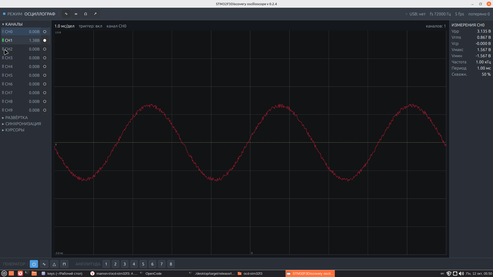
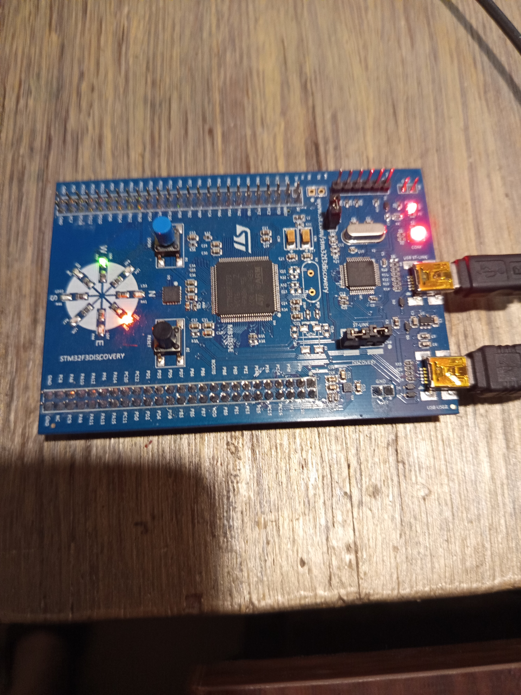

# LabBench — лабораторный измерительный комплекс на STM32F3Discovery

USB-лаборатория на плате **STM32F3DISCOVERY** (**STM32F303VCT6**, Cortex-M4F,
72 МГц): осциллограф на 10 каналов, анализатор спектра, измеритель LCR/Z и
регистратор переходных процессов (время нарастания).

Прошивка — **async Rust на Embassy** (embassy-stm32 0.6.0); десктопный фронтенд
**labbench** — нативный GUI на **Rust / gpui-kit 0.7.1** (UI-фреймворк Zed).
Никакого Python и GTK.



## Структура

```
.
├── firmware/                # Прошивка Embassy для STM32F303VC (протокол v2)
│   ├── src/main.rs          # ADC1 + DMA1_CH1 + USB CDC-ACM, цикл команд/ACK
│   ├── src/test_usb.rs      # Автономный USB smoke-тест (В сборку НЕ входит)
│   ├── memory.x             # FLASH 256K @ 0x0800_0000, RAM 40K @ 0x2000_0000
│   └── .cargo/config.toml   # target thumbv7em-none-eabi + link.x/defmt.x
├── desktop/                 # GUI "labbench" (gpui-kit 0.7.1)
│   ├── src/main.rs          # Вкладки: Осциллограф · Спектр · LCR · Transient
│   ├── src/canvas.rs        # TraceCanvas: сетка / триггер / трассы каналов
│   ├── src/dsp.rs           # БПФ (dBFS), триггер, импеданс LCR, время нарастания
│   └── src/transport.rs     # Протокол v2 поверх USB-CDC + автопоиск порта
├── 99-stm32.rules           # udev-правила: ST-LINK (0483:5710/3748) для probe-rs
├── docs/hardware_verification_plan.md  # План ручной проверки на плате
└── tmp/                     # Локальные копии официальных документов ST и демо-прошивки
```

## Подключение платы (проверено по UM1570 / DS9866 / RM0316)

Нужны **два** mini-USB кабеля одновременно:

| Разъём | Назначение |
|--------|-----------|
| **CN1** | **ST-LINK/V2** (`0483:3748`) — программирование/отладка |
| **CN2** | **USB USER** — USB устройства: **PA12 = USBDP, PA11 = USBDM** (CDC-ACM) |

### Тактирование

- **HSE: 8 МГц bypass** с выхода MCO бортового ST-LINK на **PF0/OSC_IN**
  (мост SB12; кварца X2 на плате **нет** по умолчанию, поэтому режим
  кристалла никогда не «схватился» бы). Путь MCO подтверждён UM1570 и
  официальной демо-прошивкой (`system_stm32f30x.c` выставляет `HSEBYP`).
- PLL: 8 МГц × 9 = **72 МГц SYSCLK**, AHB ÷1, APB2 ÷1 (72 МГц), APB1 ÷2
  (36 МГц).
- USB: **48 МГц = 72 / 1.5** (embassy RCC применяет автоматически при
  SYSCLK = 72 МГц).

### Карта входа АЦП (ADC1, 12 бит)

| Канал ADC1 | Пин | На P1 |
|-----------:|-----|-------|
| 1 | PA0 | P1-12 |
| 2 | PA1 | P1-5  |
| 3 | PA2 | P1-14 |
| 4 | PA3 | P1-7  |
| 5 | PF4 | P1-9  |
| 6 | PC0 | P1-6  |
| 7 | PC1 | P1-1  |
| 8 | PC2 | P1-8  |
| 9 | PC3 | P1-3  |
| 10| PF2 | P1-10 |

Важно:

- **На PA0 же висит кнопка USER (B1, перемычка SB20 замкнута)**: пин подтянут
  вверх (~3.3 В), при нажатии кнопки уходит в «0».
- Все входы опрашиваются через ADC1 в режиме continuous + circular, выгрузка
  в ОЗУ — **DMA1_CH1** (кольцевой буфер **2520** сэмплов — LCM(1..10), делится
  без остатка на любой набор активных каналов), переполнение сообщается в кадре.
- Светодиоды сигнализируют состояние прошивки — см. раздел *LED-индикация* ниже.

### Прошивка (ST-LINK + probe-rs)

Прошивка и отладка идут через бортовой **ST-LINK/V2** (`0483:3748`)
посредством [`probe-rs`](https://probe.rs):

```bash
cd firmware
cargo +nightly build --release
probe-rs run --chip STM32F303VC --scan-region ram \
  target/thumbv7em-none-eabi/release/ocd-stm32f3
```

## Сборка

Требования:

- Rust с тулчейном **nightly** — таргет прошивки `thumbv7em-none-eabi` ставится
  только для nightly, сборка прошивки — `cargo +nightly build --release`
  (`rustup toolchain install nightly && rustup +nightly target add thumbv7em-none-eabi`).
- Для desktop на Linux: десктопная сессия (gpui нужен дисплей/GPU) и `libudev`
  для сборки крейта `serialport`.
- Для прошивки: `probe-rs`; правила из `99-stm32.rules` дают доступ к ST-LINK
  (`0483:3748`) для группы `plugdev`.

Крейты embassy закреплены на ревизию git `84444a19` (тег embassy-stm32-v0.6.0) —
см. `firmware/Cargo.toml`; версии внутри кластера поднимать только синхронно.

### Прошивка

```bash
cd firmware
cargo +nightly build --release
probe-rs run --chip STM32F303VC --scan-region ram \
  target/thumbv7em-none-eabi/release/ocd-stm32f3
```

### Desktop

```bash
cd desktop
cargo build --release
cargo test          # 13 юнит-тестов (парсер протокола + DSP)
```

Запуск без железа (симулятор):

```bash
./target/release/labbench --simulate
```

Запуск с платой (CDC-ACM `ttyACM*`/`ttyUSB*`/`COMx` определяются сами):

```bash
./target/release/labbench --port /dev/ttyACM0 --baud 115200
```

(`--baud` принимается для совместимости; CDC-ACM его игнорирует.)

## Протокол по USB (v2)

### Кадр данных MCU → PC — `5 + 2·nch` байт

```
AA 55 <flags> <seq> <nch> <ch0_lo> <ch0_hi> ... <ch(n-1)_lo> <ch(n-1)_hi>
```

- `AA 55` — маркер синхронизации
- `flags` — бит 7 = переполнение ADC (данные потеряны); остальные зарезервированы
- `seq` — номер кадра, обёртка по модулю 256 (desktop считает потерянные кадры)
- `nch` — число каналов в кадре (1..10)
- сэмплы — 12-битные значения ADC, little-endian `u16`. Desktop приводит
  сырое значение `r` к долям шкалы: `r / 2047.5 − 1.0`
  (0x0000 → −1.0, 0x0FFF → ~+1.0).

### Команды PC → MCU

| Команда     | Код   | Полезная нагрузка                       |
|-------------|:-----:|-----------------------------------------|
| SET_RATE    | `0xA0`| `<level 0..7>` — 3-битное время выборки АЦП |
| SET_CHANNEL | `0xB0`| `<ch> <enable> <sample_time>`           |
| GET_MASK    | `0xB2`| —                                       |
| SET_GEN     | `0xC0`| `<cfg>` — тестовый генератор (см. ниже)  |

### ACK MCU → PC

| ACK          | Код  | Полезная нагрузка                            |
|--------------|:----:|----------------------------------------------|
| ACK_RATE     | `0xA1`| `<level>`                                   |
| ACK_CHANNEL  | `0xB1`| `<ch> <enable> <sample_time>`               |
| ACK_MASK     | `0xB3`| `<mask_lo> <mask_hi>` (маска включённых каналов) |
| ACK_FS       | `0xA4`| `<fs: u32 LE>` — **измеренный** темп сканов, Гц |

`ACK_FS` шлётся периодически (~0.5 с) во время потока: прошивка измеряет,
сколько сканов реально выдано, и сообщает фактическую частоту на канал.
Desktop использует именно это значение в расчётах БПФ и LCR, а не таблицу
времён выборки — спектр и импеданс остаются корректными при любой комбинации
включённых каналов и времени выборки.

Все ACK уходят через Sender задачи потока кадров (единственный владелец
IN-эндпоинта) — данные и ACK никогда не перемешиваются.

## Тестовый генератор (DAC1) и LED-индикация

В прошивке есть небольшой калибровочный генератор на **DAC1_OUT1 = PA4**
(P1-16). Управляется командой `0xC0` — один байт конфигурации:

| Бит(ы) | Назначение                                                |
|--------|-----------------------------------------------------------|
| 0      | включение: 0 = выкл, 1 = вкл                              |
| 2:1    | форма: 0 = постоянный уровень (середина), 1 = синус, 2 = треугольник, 3 = меандр |
| 5:3    | уровень амплитуды 1..8 (размах ≈ `128·n` кодов вокруг середины) |

Сигнал синтезируется программно: **20 отсчётов на период при фиксированном
такте 20 кГц (≈1 кГц)**, 12-битный ЦАП, в полный размах на PA4. Desktop
`labbench` выводит это как панель *Генератор*: пиктограммы формы (`○ ∿ △ ⊓`),
явный переключатель амплитуды `1..8` и серый вид, пока генератор выключен, —
щуп осциллографа на PA4 даёт самопроверочный сигнал без внешней обвязки.

Окно desktop организовано так: верхний тулбар (индикатор «РЕЖИМ» + вкладки-
пиктограммы: Осциллограф `∿`, Спектр `≡`, LCR `Ω`, Переходный `↗`), **левая
панель управления** со сворачиваемыми секциями (аккордеон: *Каналы* ·
*Развёртка* · *Синхронизация* · *Курсоры* — открыта не более одной), область
графика (сетка с подписями осей в вольтах и мс), **колонка измерений** справа
от графика и полоса генератора, прижатая к нижней границе окна.

В секции «Каналы»: цветовой маркер вкл/выкл, выбор активного канала (клик по
`CHn`, трасса подсвечивается) и текущий Vpp. В колонке измерений — Vpp · Vrms ·
Vср · Vмакс · Vмин · частота · период · скважность активного канала. Прочие
органы: развёртка (время/дел, В/дел), кнопка **АВТО** (подстройка мс/дел и
В/дел под сигнал), тумблер триггера, **выбор частоты выборки** АЦП (уровень
времени выборки), **смещение** трассы активного канала и **курсоры A/B** с
отсчётом ΔT · 1/ΔT · ΔV. Вкладка Спектр добавляет выбор окна (Ханна ·
Хэмминга · Блэкмана · прямоугольное), экспоненциальное усреднение, маркер пика
(`f₀`, дБ) и фиксированную шкалу −120…0 дБ. В полосе генератора активная форма
и выбранная амплитуда подсвечиваются акцентным цветом.

### LED-индикация

Светодиоды платы (включаются высоким уровнем; LED в GND через ~510–680 Ом)
показывают состояние прошивки:

| LED  | Цвет     | Пин  | Назначение |
|------|----------|------|-----------|
| LD4  | синий    | PE8  | heartbeat — мигает, пока прошивка жива |
| LD5  | оранжевый| PE10 | USB-CDC подключён (хост открыл порт) |
| LD6  | зелёный  | PE15 | идёт поток кадров данных |
| LD7  | зелёный  | PE11 | тестовый генератор включён |
| LD10 | красный  | PE13 | тревога — переполнение ADC/потеря ACK (мигает ~4 с) |



## Статус

- Прошивка: сборка с **0 предупреждений**; ADC1 + DMA1_CH1 сверены со
  справочником (карта регистров, раскладка SQR/SMPR, смещение DR = 0x40).
- Desktop: сборка с **0 предупреждений**; юнит-тесты (13) проходят. Новые
  функции UI: измерения активного канала, курсоры с дельтами, окна FFT с
  усреднением и маркером пика, авто-развёртка, выбор частоты выборки, смещение
  трассы.
- `firmware/src/test_usb.rs` — унаследованный автономный USB-тест; для сборки
  раскомментируйте запись `[[bin]]` в `firmware/Cargo.toml`.

Пошаговый ручной прогон на реальной плате — в
`docs/hardware_verification_plan.md`.